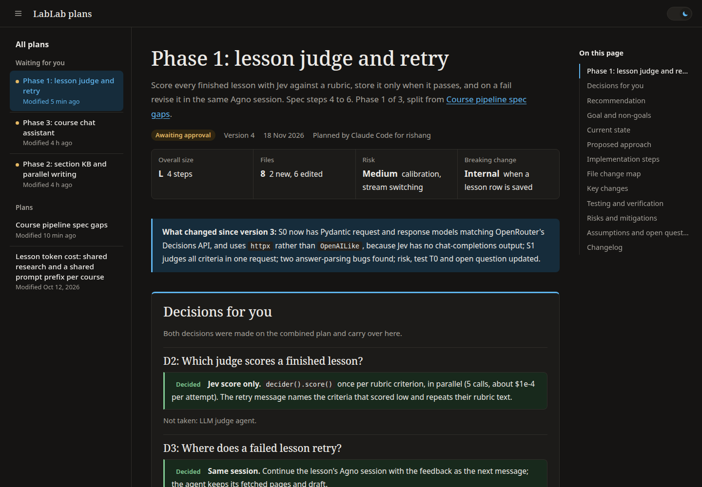

# Skills

| Skill | Description |
|-------|-------------|
| [html-plan-report](html-plan-report/SKILL.md) | Writes a coding task's implementation plan as one self-contained HTML page, opens it in the browser, settles decisions in the terminal, and waits for a go-ahead before any code is written. |

## Demo

### html-plan-report

